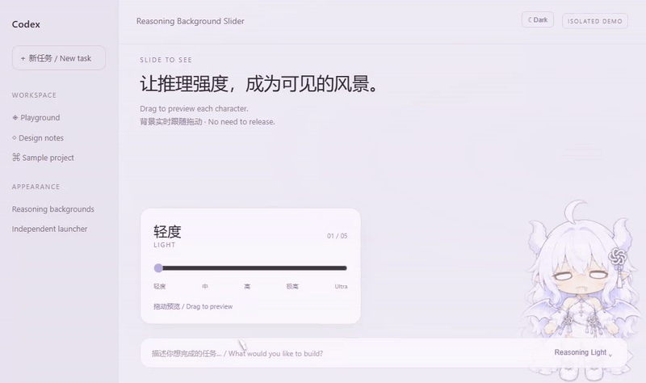
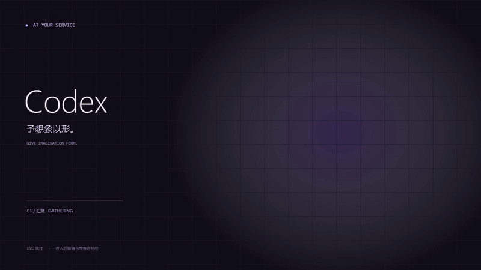

# Codex Reasoning Background Slider

**Codex 推理背景滑块**

**English** | [简体中文](README.zh-CN.md)

**v1.0.1 release** · [Download for Windows x64](https://github.com/SkyJiashu/codex-reasoning-background-slider/releases/tag/v1.0.1)

Drag Codex's native reasoning-effort slider to preview a matching dragon-girl background. Five stages differ in pose, costume and wing span. Ultra adds local purple accents and stars. A locally cached data-to-character startup animation is also included.

This is an independent community launcher for the Windows Codex desktop app, with no affiliation to OpenAI. It uses its own entry point and preserves the official application and shortcuts.

Five authorized character images are included. Both project code and artwork use noncommercial licenses, as described below.

## Have your agent install it

Copy the following prompt to your own agent. See the [full English installation guide](docs/install-agent.en.md) for the complete procedure.

```text
Please automatically install Codex Reasoning Background Slider:
https://github.com/SkyJiashu/codex-reasoning-background-slider
First read and review the repository README and https://github.com/SkyJiashu/codex-reasoning-background-slider/blob/main/docs/install-agent.en.md in full, then follow the guide.
I authorize installing this project and the necessary local FFmpeg dependency, creating its own shortcut, and verifying it with an offline preview that does not launch Codex.
Preserve official Codex and its original entry points. Do not read authentication configuration. If Codex is running, finish installation preparation without closing it.
Report the installed version, directory, verification results and the entry point I should use next.
```

## Demos

### Reasoning backgrounds



An isolated demo using the actual skin logic. It shows drag previews, stage backgrounds and Ultra styling. In normal use, Codex's native controls provide the selected effort.

### Local startup animation



The first launch generates an animation cache for the user's display and DPI; later launches play that cache. The repository and runtime packages do not contain a pre-rendered startup movie. This GIF documents the effect only.

## Features

- Five character backgrounds follow native reasoning controls and preview while dragging. Ultra adds local purple accents and stars, with separate light- and dark-theme adaptation.
- While native controls initialize, the last confirmed character image provides visual continuity. Once ready, the background follows the actual effort. The program does not change the model or reasoning setting for the user.
- First use generates a local animation cache for the display work-area resolution and DPI. Matching caches are reused; renderer-code or artwork changes generate a new cache.
- Playback uses a local 60 fps movie instead of calculating particles and text in real time. No pre-rendered movie is included in source or runtime packages.
- Codex starts and prepares its background behind the animation. After playback ends, it holds for about 0.3 seconds, then fades out over about 0.55 seconds. Press `Esc` to skip.

## Requirements

- Windows x64, .NET Framework 4.8 and working system media components.
- An installed official Codex desktop client discoverable through Windows package registration. Other installation formats may need adaptation.
- **FFmpeg with `libx264` is required for first-time cache generation.** Place `ffmpeg.exe` beside the launcher or install it as a system-discoverable command. Playing an existing cache does not invoke the encoder again.
- Node.js is for development tests only. `ffprobe` is for developers checking encoded media.

The launcher itself does not automatically download or install third-party programs. The prompt above authorizes the user's own agent to prepare the required dependency.

## Use the release package

Download the Windows x64 runtime archive from the [latest release](https://github.com/SkyJiashu/codex-reasoning-background-slider/releases/latest), extract it to a directory you will keep, and prepare FFmpeg. Save your work, completely exit Codex, then double-click `CrystalDragon.exe`. This executable filename is retained for compatibility with existing installations. You can also run `Install-Shortcut.cmd` to create the independent **Codex Reasoning Slider** desktop entry.

First use generates the animation cache locally. Neither source nor runtime packages include pre-rendered startup movies.

## Build from source

The required character images are included. Open PowerShell in the project directory and run:

```powershell
.\scripts\build.ps1
```

The output is in `build/CrystalDragon/`.

1. Save your work and completely exit Codex, including any client still running in the background.
2. Double-click `CrystalDragon.exe` or `Start-Cold-Test.cmd` in that directory.
3. First use displays local cache-generation progress, which can be canceled. Once complete, it plays the animation and starts Codex.
4. Later launches reuse the cache. Display specifications, renderer code or character-image changes generate the corresponding cache automatically.

Run `Install-Shortcut.cmd` if you want a desktop entry. It only creates this project's independent shortcut and does not scan, replace or bind official entries. Keep the extracted or built directory in a permanent location.

To use the taskbar, pin this shortcut. The launcher gives the Codex window its own identity and icon, so the window groups under this shortcut, apart from the official icon. The official icon is pinned by app package and still opens the stock client, and the launcher cannot rewrite it; unpin it if you do not need it. You can also right-click the taskbar button of a launcher-started Codex and pin it, which also goes through the launcher.

By default, original shortcuts continue to open the official client directly. For the animation and background, fully exit any existing client first. If Codex is already running, the launcher does not take it over and brings its window to the front instead; a client not opened by this launcher stays without the background.

The client uses its registered package's default profile, as a normal official launch does. The launcher discards inherited development overrides for the client profile and build flavor in its own process only, removing one source of separate profile and single-instance contexts. It does not move or delete earlier profiles or change persistent user or system settings; login and window state follow the official default profile. Notification routing remains native and is not replaced by shortcut binding. Cold-start notification-click behavior has not yet been verified end to end.

### Optional: use the launcher for existing Codex shortcuts

After the first successful real launch, the project asks whether to route current-user Codex desktop/Start Menu shortcuts through it. **No is the default.** Yes creates local backups before changing eligible plain `.lnk` files; Cancel postpones the question. The installation agent and offline preview never make this choice for you.

Run `Manage-Entrypoints.cmd` later to bind or restore. Choosing restoration disables automatic rebinding. Previously opted-in links can follow a newer launcher installation only while they still match this project's saved state; external edits and deletions are preserved.

This is shortcut binding, not a replacement for every Windows activation path. Protocol handlers, taskbar pins, virtual MSIX Start entries and official-update restarts are unchanged. A stock-looking window alone does not establish that another process was launched. The launcher recognizes the exact Codex package family across versions with the same executable basename and retains its own single-instance guard, but cannot control all external activations.

## Preview and restore

| Entry | Behavior |
| --- | --- |
| `CrystalDragon.exe` / `Start-Cold-Test.cmd` | Start a new Codex session through the animation and apply the backgrounds |
| `Preview.cmd` | Preview only; may generate a cache on first use, without starting Codex |
| `Restore.cmd` | Request removal of the backgrounds, styling and listeners applied by this launcher |
| `Manage-Entrypoints.cmd` | Choose optional shortcut binding or restore locally backed-up links |

Restoring appearance does not close Codex. The helper keeps its connection alive until the client it launched exits normally. To start through the official entry again, first completely exit the current session.

## Cache and local data

Animation caches live under `CrystalDragon/animation-cache` in the current user's local application-data directory. This internal directory name is retained for cache compatibility and is not committed to the repository. The playback window follows Codex's position, size and DPI while preserving character proportions. Resizing during playback does not re-encode the movie.

The launcher's `appearance-stage.txt` stores only the last visual stage confirmed by native controls. A provisional startup portrait is not treated as the actual reasoning effort and does not activate Ultra colors early.

`qa/status.json` and `qa/handoff.json` record fixed states, timings and error categories, not chat text, typed input or authentication configuration. Review attachments before reporting an issue; do not upload account configuration or full client logs.

## Compatibility

Background detection depends on interface attributes exposed by the client and may require adaptation after client updates. Unknown, ambiguous or unsupported controls are never guessed to be the highest effort.

The launcher resolves the client version from the Windows package registration on every launch, so updates need no reconfiguration. The first launch after a Codex update may migrate local data and sit on the startup logo for minutes. Do not close the window then: later launches can fail with `timed out waiting for state db backfill`. To recover, wait about 15 minutes, launch once more and let it finish.

If the background stops following the effort control after an update, run `node scripts/check-client-compat.cjs`. It only reads the installed client package and lists any interface attributes the skin needs that have disappeared.

The default mapping has five groups: `none/minimal/low`, `medium`, `high`, `xhigh` and `max/ultra`. If a model's highest available effort is only `high` or `xhigh`, it is not automatically mapped to Ultra.

Handoff does not wait for every background request; the native page may continue loading. A playback-decoding failure retains a still frame and records a failure state.

## Development

```powershell
# Frontend behavior checks
node --test tests/skin.test.cjs tests/preload.test.cjs

# Full local Windows checks
.\scripts\test.ps1

# Package source and runtime files
.\scripts\package-source.ps1
.\scripts\package.ps1
```

Full checks include local cache generation, actual video playback and official-client identity probes. They require the environment above and an installed client. Tests do not start or modify an existing Codex instance.

`scripts/build.ps1` compiles the launcher and cache renderer without generating a pre-rendered movie. `scripts/render-film.ps1` is a manual encoding-check tool for development. See [docs/architecture.md](docs/architecture.md) for the architecture.

## Licenses and attribution

Project additions use the [PolyForm Noncommercial License 1.0.0](LICENSE): the source is available for noncommercial purposes permitted by those terms, without a commercial-use grant. This is not an OSI-approved open-source license.

Upstream MIT material retains its original license. This project's noncommercial terms do not revoke existing upstream permissions. See [THIRD_PARTY_NOTICES.md](THIRD_PARTY_NOTICES.md) for sources and retained notices.

The five bundled character images use [CC BY-NC 4.0](ARTWORK_LICENSE.md), without a commercial-use grant. The maintainer has confirmed ownership or authorization to publicly redistribute them. The artwork involves AI generation or editing. No rights in third-party brands or marks are granted. See the [artwork guide](assets/README.md) for custom images.
