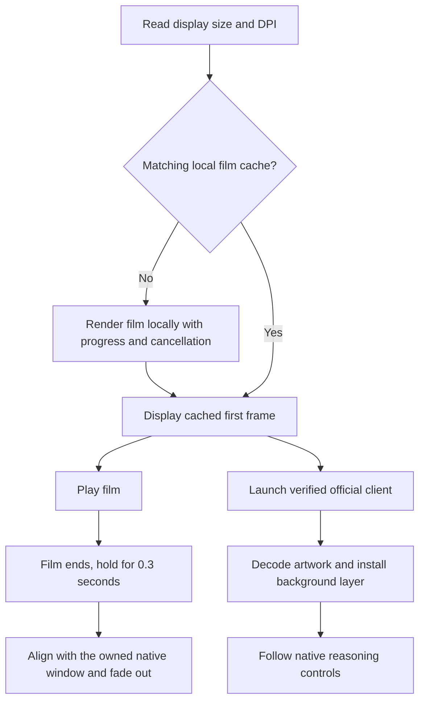

# Architecture

The project is an independent Windows launcher. It prepares a local startup-film cache, launches the registered official client, and adds a visual layer through a private connection to the newly created process. It does not replace the official application files or automatically retarget existing shortcuts.

## Startup flow

The first opaque frame is presented before the client is created. Film playback and native startup then run concurrently. Handoff follows the actual media-end event and a short hold. Native-window ownership and visibility are checked before revealing it; editor readiness does not extend the film.

## Main components

| Component | Responsibility |
| --- | --- |
| `OfficialIdentity.cs` | Discover the registered client, validate its signature and execution alias |
| `PipeHost.cs` | Create the client with private inherited handles and retain its process identity |
| `Launcher.cs` | Coordinate preparation, launch, background installation and handoff |
| `CachePreparation.cs` / `MovieCache.cs` | Present first-use progress and manage reusable local caches |
| `DataScene.cs` / `tools/RenderFilm.cs` | Render the authored animation during cache generation |
| `FilmSurface.cs` | Play the cached movie and show its first/end poster frames |
| `NativeWindow.cs` | Match the owned window's geometry and transfer visibility/focus |
| `skin.js` / `skin.css` | Follow native effort controls and apply local visual styling |
| `preload.js` | Sample structural preparation state for diagnostics |

## Cache boundary

A cache key incorporates physical work-area dimensions, DPI, the animation-renderer fingerprint and the startup character image hash. A cache is reused only when its completion marker and expected outputs are present. The marker is written after the renderer succeeds. Concurrent requests for the same cache share generation; cancellation stops only the owned renderer and leaves the result uncommitted.

The cache contains the movie and its first/end PNG frames. These files remain in the current user's local application data directory and are excluded from source and runtime distributions. Runtime packages contain the compiled renderer, which is built from the included source.

FFmpeg with `libx264` is needed on a cache miss. A cache hit does not require the encoder. Display specifications are checked at startup; resizing the playback window uses proportional presentation rather than re-encoding the film.

## Background preparation

Artwork decoding begins in the verified Electron document before the application shell is ready. The layer can be installed once the document head and body exist, allowing the native interface to mount later.

Native effort controls remain authoritative. Before the first confirmed value, the last confirmed visual stage may provide a neutral provisional portrait. The first launch uses the film's character. This decoration neither claims a native effort value nor activates Ultra colors or stars. First native confirmation permanently retires the startup fallback; subsequent changes follow the controls directly.

The last confirmed visual stage is stored as a bounded digit in the launcher's own `appearance-stage.txt`. It does not contain a model name, chat identifier or input text.

## Process and data boundaries

- The launcher works with the client process it creates and validates; an already-running client is not taken over.
- The connection uses private inherited pipes rather than a TCP debugging listener.
- Closing the visual splash does not close the client connection. The helper keeps the transport alive until its client exits.
- Restore removes the project's styling, artwork and listeners without closing Codex.
- Background detection reads interface attributes and geometry, not chat content, typed prompts or authentication configuration.
- Diagnostics record fixed states, timing values and error categories. Generated caches, user state and development artifacts do not belong in a public repository.

## Compatibility

The visual adapter depends on native interface attributes that may change between client versions. Unknown, ambiguous and unsupported control values are handled neutrally. No assumption is made that every model exposes the same number or meaning of effort stops.

The official client may continue loading after handoff. Local film and background preparation reduce visual work during startup, but they do not replace or redefine the client's own loading lifecycle.
